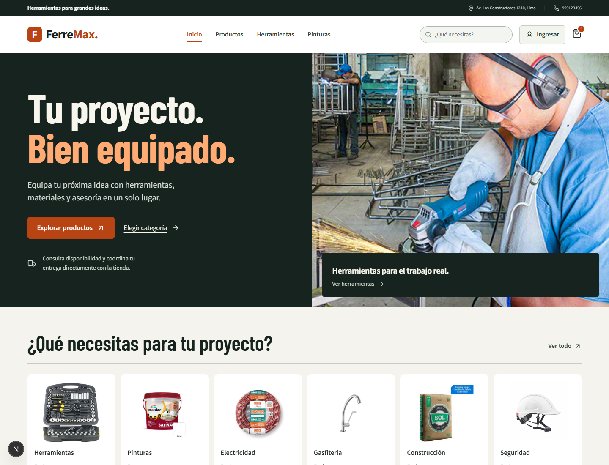
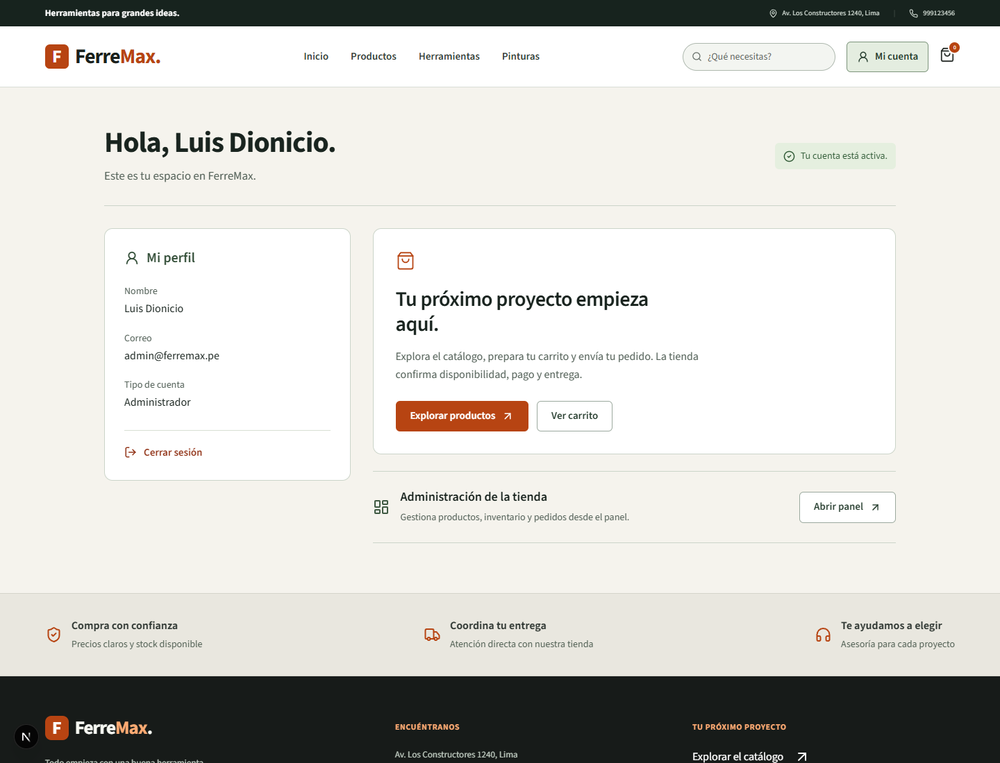

# Refinamiento de UI y pantalla de cuenta

Se mantiene la identidad de FerreMax (grafito, naranja, superficies claras y fotografías reales) y se mejora la lectura de tienda, catálogo, ingreso, cuenta y panel.

## Tipografía y contraste

- Barlow Condensed 600/700 para títulos de portada y secciones: una voz industrial con mayor jerarquía.
- Source Sans 3 variable 400–700 para lectura, formularios, productos y administración.
- Fuentes WOFF2 almacenadas en `frontend/public/fonts/`, precarga de los dos archivos principales y `font-display: swap`. No se depende de una petición a Google Fonts durante la visita.
- Naranja de acción `#b74412` con texto blanco; acento claro `#ffab73` sobre superficies oscuras. Texto principal `#19241f` y secundario `#526057` sobre superficies claras.
- Relaciones calculadas con luminancia sRGB: acción/blanco 5,46:1; texto secundario/fondo claro 5,97:1; acento claro/grafito 8,74:1.
- Mayor tamaño de texto secundario, precios con cifras tabulares, foco visible y controles táctiles de al menos 44 px en los recorridos principales.

Fuentes: [Barlow Condensed en Google Fonts](https://fonts.google.com/specimen/Barlow+Condensed) y [Source Sans 3](https://fonts.google.com/specimen/Source+Sans+3). Las licencias OFL se conservan junto a los archivos locales. Los nombres tipográficos históricos de algunos selectores se resuelven a la nueva fuente de lectura mediante alias locales.

## Portada y pantallas

La portada incorpora una fotografía de aplicación Bosch publicada por Promart, ya documentada en el proyecto. La jerarquía diferencia el acceso al catálogo y la navegación por categorías. El catálogo conserva las 48 fichas y todas sus operaciones.



En **Mi cuenta**, el encabezado presenta saludo y estado. El perfil contiene nombre, correo y rol; el cierre de sesión se separa de la compra. La zona principal contiene catálogo y carrito. El acceso al panel aparece solo para personal autorizado y ocupa una fila propia. En móvil, los bloques se apilan y la cabecera mantiene cuenta, carrito y menú accesibles.



| Pantalla | Evidencia |
| --- | --- |
| Portada anterior | [Captura](previews/12-ui-antes.png) |
| Catálogo | [Captura](previews/14-ui-catalogo.png) |
| Ingreso | [Captura](previews/15-ui-acceso.png) |
| Panel administrativo | [Captura](previews/17-ui-panel.png) |
| Portada móvil | [Captura](previews/18-ui-movil.png) |
| Cuenta móvil | [Captura](previews/19-ui-cuenta-movil.png) |

Son capturas de pantallas implementadas en Next.js y conectadas a Express/MySQL, con datos de demostración.

## Verificación

`scripts/verify-ui.mjs` registra capturas y ejecuta la regla `color-contrast` de axe en portada, catálogo, ingreso, cuenta y dashboard de escritorio, y portada/cuenta móvil. El informe está en [ui-contrast-report.json](previews/ui-contrast-report.json). Cero incidencias de esa regla no equivale a una certificación integral WCAG; los gráficos y estados no renderizados requieren su propia revisión.

Las pruebas Playwright cubren además el rol cliente sin acceso al panel, cierre de sesión, fuentes cargadas y controles de cabecera dentro del viewport en 320, 375, 768 y 1440 px. Se conservan los recorridos de carrito, pedidos, inventario, registro y administración.

Para repetir:

```bash
npm run dev
# En otra terminal:
npm run test:e2e
node scripts/verify-ui.mjs
```

En Windows con Edge instalado: `$env:PLAYWRIGHT_CHANNEL='msedge'` antes de ejecutar los comandos de navegador.
