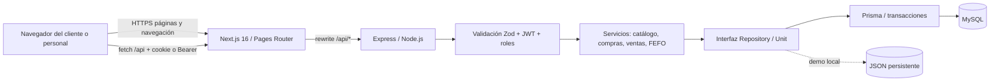
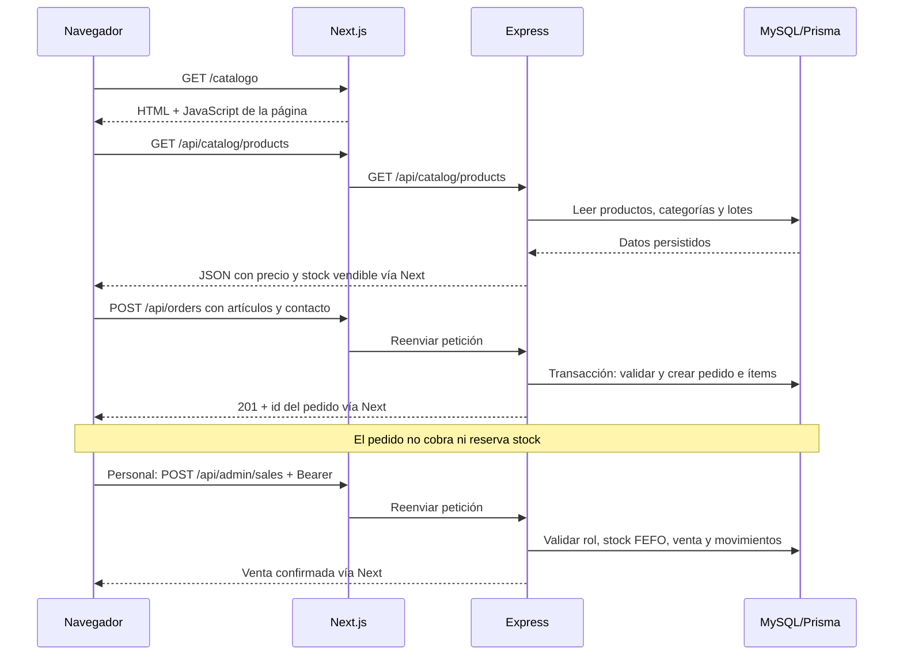

# Arquitectura y comunicación cliente-servidor

Next.js y Express son procesos independientes. El navegador usa una sola URL para web y API: Next reenvía las peticiones mediante `rewrites` a `API_ORIGIN`. No hay API comercial implementada dentro de Next ni secretos publicados como variables NEXT_PUBLIC.

## Autenticación

1. El formulario envía email y contraseña a Express a través de Next.
2. Express compara bcrypt y devuelve un JWT de 15 minutos; el refresh de 7 días se guarda como cookie HttpOnly, SameSite Strict y Secure en producción.
3. El JWT se mantiene en memoria y se envía como Bearer. La sesión se restaura con `/auth/refresh` y se rota el token de refresco.
4. Express consulta el usuario activo y verifica permisos. Ocultar botones en frontend no constituye autorización.

## Renderizado

Se usa Pages Router con páginas por archivo, HTML prerenderizado e hidratación. El catálogo se consulta a Express en cliente tras montar el proveedor de contexto; no se declara SSR de productos ni ISR. El estado del carrito se restaura después del montaje para evitar diferencias entre servidor y navegador.

## Variables

`API_ORIGIN`: solo servidor Next. `DATABASE_URL`, `JWT_SECRET`, `FRONTEND_URL`, `DATA_DRIVER`, `PORT` y `TRUST_PROXY`: Express. Los archivos `.env` están ignorados; `.env.example` describe los valores necesarios.
