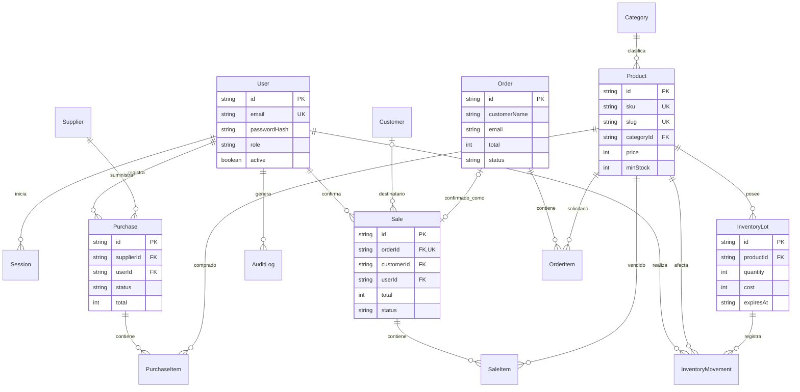

# Modelo entidad-relación y elección de base de datos

## Por qué MySQL

FerreMax conecta productos, categorías, proveedores, compras, lotes, ventas y usuarios. Una venta puede consumir varios lotes y debe actualizar existencias y registrar movimientos en una sola transacción. MySQL aporta claves foráneas, índices, unicidad y transacciones serializables. Prisma define el esquema y permite migraciones versionadas. No se eligió una base documental porque aquí predominan relaciones y consistencia transaccional, no documentos independientes.

El modo JSON es un repositorio alternativo para demostración local: serializa las escrituras y persiste de forma atómica, pero no sustituye MySQL en nube. La configuración de producción rechaza JSON.

## Diagrama

Disponible también como [imagen PNG completa](diagramas/01-modelo-er.png) y [SVG vectorial](diagramas/01-modelo-er.svg), generados desde el esquema real. El Mermaid de esta sección resume el núcleo transaccional para explicarlo con menos detalle.

El esquema completo y definitivo, incluidos `Setting`, `Renewal`, campos secundarios e índices, está en `backend/prisma/schema.prisma`. La migración inicial está en `backend/prisma/migrations/20261114000000_initial`.

## Decisiones que se deben explicar

- Dinero en céntimos enteros: 47990 representa S/ 479.90. Se evita el redondeo de coma flotante.
- El stock se obtiene de los lotes; no se mantiene un contador duplicado en Producto.
- FEFO: se consumen primero los lotes válidos que antes vencen. Los vencidos no son vendibles.
- Pedido pendiente no reserva stock. Al confirmar se recalculan precios y se vuelve a validar disponibilidad.
- El correo del usuario es único; el rol público siempre es CUSTOMER. Los contactos comerciales Customer no son credenciales de autenticación.
- El pedido guarda sus datos de contacto y no tiene una relación automática con User. No se promete historial privado de pedidos ni verificación de correo.
- Una venta tiene `orderId` único para impedir confirmar dos veces el mismo pedido.
- Desactivar productos conserva sus relaciones históricas.
- Las fechas de vencimiento usan YYYY-MM-DD y las operaciones instantes UTC ISO.
