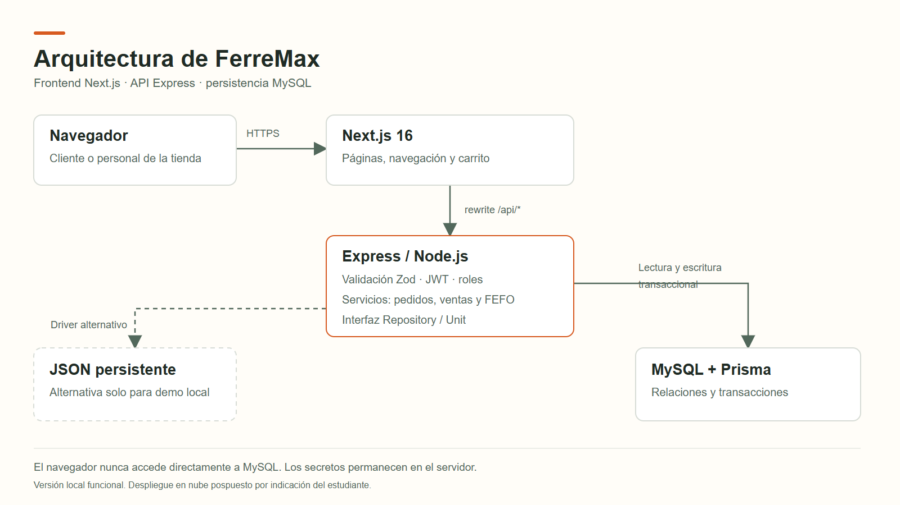

# Imágenes para la presentación

Estos archivos corresponden a la implementación de FerreMax. Se generaron y revisaron como diagramas técnicos, no como fotografías inventadas.

| Imagen | PNG para diapositivas | SVG vectorial |
| --- | --- | --- |
| Modelo E-R completo | [01-modelo-er.png](01-modelo-er.png) | [01-modelo-er.svg](01-modelo-er.svg) |
| Arquitectura en formato 16:9 | [02-arquitectura.png](02-arquitectura.png) | [02-arquitectura.svg](02-arquitectura.svg) |
| Secuencia cliente–Next–Express–DB | [03-flujo-cliente-servidor.png](03-flujo-cliente-servidor.png) | [03-flujo-cliente-servidor.svg](03-flujo-cliente-servidor.svg) |

El E-R se deriva automáticamente de `backend/prisma/schema.prisma`: incluye entidades, campos escalares, PK, FK, UK y relaciones declaradas. `nullable` indica un campo opcional. Los nombres de tipos siguen Prisma; no son una transcripción de tipos SQL. `Setting` y `Renewal` aparecen sin relaciones porque así están definidos en el esquema. No se inventa una relación User–Order.

La arquitectura es una composición SVG 1600×900 para presentar por capas. Su fuente editable está en `scripts/generate-diagrams.mjs`. La versión Mermaid equivalente y la secuencia proceden de `docs/ARQUITECTURA_CURSO.md`. Los archivos `.mmd` se conservan junto a las exportaciones.

## Volver a generar

```bash
npm ci
npx playwright install chromium
npm run docs:diagrams
```

En Windows con Edge instalado puede usarse `$env:PLAYWRIGHT_CHANNEL='msedge'` antes del último comando. El generador usa Mermaid y un navegador de Playwright para exportar PNG y SVG. No descarga imágenes de productos ni necesita credenciales de la aplicación.

Usar SVG cuando se necesite ampliar el E-R completo sin pérdida. La arquitectura cabe en una diapositiva 16:9; la secuencia puede ocupar una diapositiva vertical o ampliarse por pasos durante la exposición.


